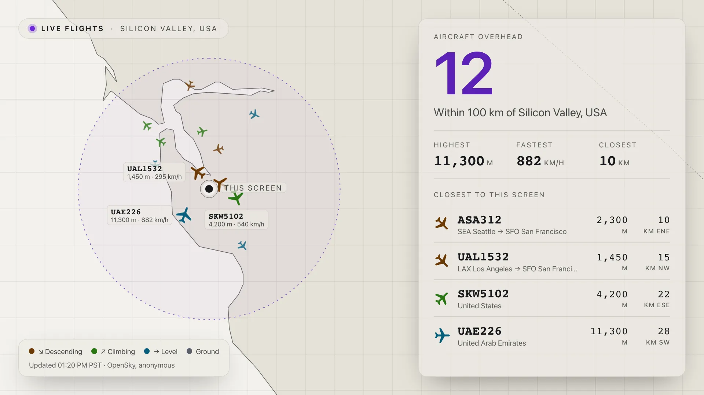
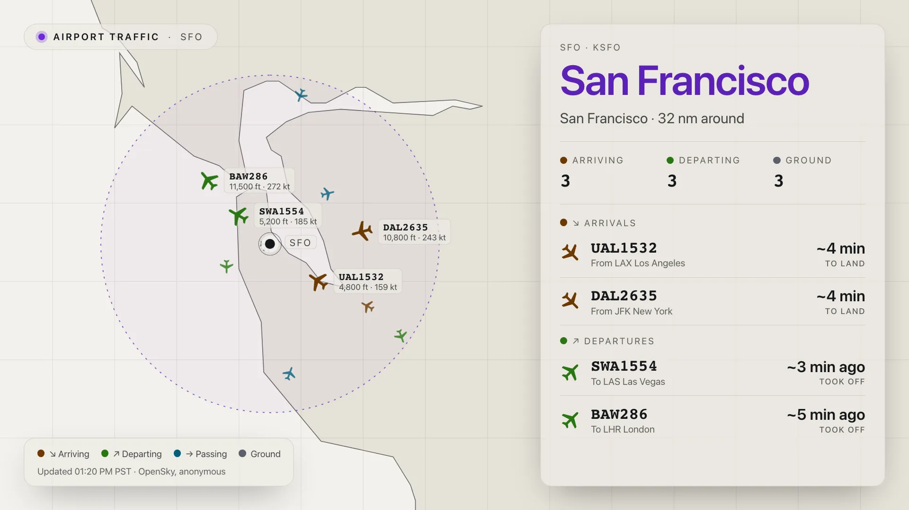
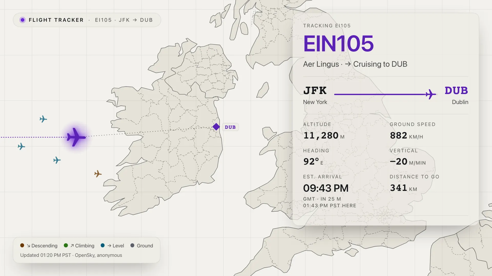
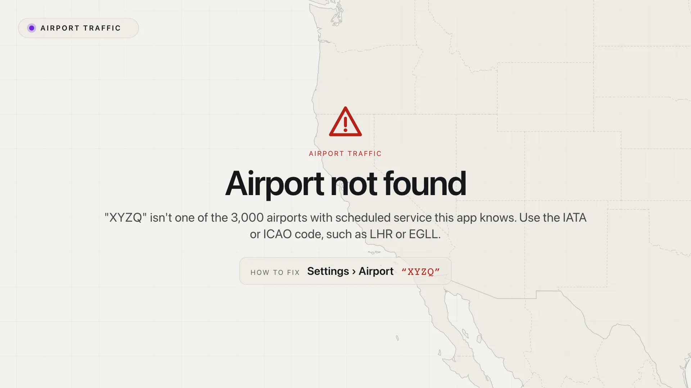

[](https://github.com/Screenly/opensky-live-app/releases/latest)

# OpenSky Live: Screenly Edge App



Live air traffic from [The OpenSky Network](https://opensky-network.org/) on a
full-bleed map, with the numbers in glass panels. Pick a mode with **What to
Show**:

| Mode                   | Setting values                  | Shows                                                                                |
| ---------------------- | ------------------------------- | ------------------------------------------------------------------------------------ |
| **Around this screen** | `mode: area`, `radius`          | Every aircraft in range; the highest, fastest and closest, with where each is going. |
| **Airport**            | `mode: airport`, `airport`      | Arriving, departing and ground counts, and an Arrivals / Departures board.           |
| **Flight**             | `mode: flight`, `flight_number` | One flight across the map: status, From → To with progress, estimated arrival, path. |




Aircraft are coloured by **what they are doing**, and every colour also has a
word or arrow, so colour is never the only cue. The followed flight is purple.

| Colour (dark / light theme)         | At an airport | Anywhere else |
| ----------------------------------- | ------------- | ------------- |
| Orange `#cc7200` / brown `#6b3903`  | ↘ Arriving    | ↘ Descending  |
| Green `#7ac869` / green `#297613`   | ↗ Departing   | ↗ Climbing    |
| Sky blue `#a6e1fe` / teal `#055e7c` | → Passing     | → Level       |
| Grey `#8f98a8` / grey `#5a606b`     | Ground        | Ground        |

Altitude is OpenSky's pressure altitude, so a flying aircraft can read 0 or
below. Under 100 ft shows **<100 ft**; on the ground shows **GND**. Between
refreshes, aircraft keep moving along their last course and speed.

## Settings

| Setting                               | Default            | What it does                                                                                      |
| ------------------------------------- | ------------------ | ------------------------------------------------------------------------------------------------- |
| **What to Show**                      | Around this screen | The mode.                                                                                         |
| **Airport**                           |                    | Airport mode. IATA or ICAO code (`LHR` or `EGLL`). About 3,000 airports are bundled.              |
| **Flight Number**                     |                    | Flight mode. A ticket number (`BA283`), ICAO callsign (`BAW283`) or ICAO24 address (`4ca7b5`).    |
| **Units**                             | Metric             | Metric (km, m, km/h), Aviation (nm, ft, kt) or Imperial (mi, ft, mph). Range uses the same unit.  |
| **Range**                             | Area (100)         | How far to look: Nearby 50, Area 100 or Region 200, in the chosen Units.                          |
| **Theme** (advanced)                  | Dark               | Dark (radar) or light (paper).                                                                    |
| **Show Private Flights** (adv.)       | off                | Also list aircraft flying under their registration.                                               |
| **OpenSky Client ID / Secret** (adv.) |                    | Optional sign-in for ten times the allowance (see _OpenSky credentials_).                         |
| **Refresh Interval** (adv.)           | 300 s / 60 s       | Seconds between requests; blank is 300 anonymously, 60 signed in, and never faster than 240 / 30. |
| **Override Coordinates** (adv.)       |                    | Use this location (`51.4700,-0.4543`) instead of the screen's; also sets the timezone.            |
| **Override Timezone** (adv.)          |                    | Timezone for times on screen (`America/Los_Angeles`).                                             |
| **Override Locale** (adv.)            | `en`               | How numbers and times are written (`fr`, `de`, `pt-BR`). Labels stay in English.                  |
| **Display Errors** (adv.)             | off                | Show OpenSky errors instead of the last good reading. For debugging.                              |
| **Sentry Client Key**                 |                    | Error reporting, global to the account.                                                           |

## Airport mode

| Section          | Each row                                      | Time                                 |
| ---------------- | --------------------------------------------- | ------------------------------------ |
| **↘ Arrivals**   | callsign, _From LAX Los Angeles_ (or country) | **~5 min** to land, or **Landing**   |
| **↗ Departures** | callsign, _To LAS Las Vegas_ (or country)     | **~4 min ago**, or **Just departed** |

- A descending aircraft heading for the airport is an arrival; a climbing one
  heading away is a departure. Within 6 km only climb or descent counts.
- Arrivals are sorted by soonest to land, departures by latest to take off.
- Times are estimates (**~**) from distance and speed; OpenSky has no schedules.
- Ground aircraft are counted within 6 km but not listed. Overlapping ground
  icons are thinned to two on the map.
- Flights bound for a nearby airport (Gatwick, seen from Heathrow) are left
  off the board.

## Private flights

Aircraft flying under their **registration** (N780SP) identify their owner, so
by default they are drawn on the map but never named, listed or counted. A
callsign with an operator code and a number (UAL1050) counts as public.
Business-jet operators (NetJets, Flexjet, VistaJet and others) are listed as
**Private jet · Flexjet**. **Show Private Flights** lists everything. Flight
mode always follows what was typed.

## Routes

Routes come from OpenSky's flight-route service (the one behind its live map),
with [adsbdb](https://www.adsbdb.com/) as the fallback. Both are free and use
no credits. The leg being flown is used; a route the aircraft is clearly not
on (a reused flight number) is hidden and the row shows the country instead.
Lookups are batched and cached on the screen.

## Flight mode

The panel says who flies it and what it is doing (**Alaska Airlines · →
Cruising to HNL**), with both airports, a progress bar, the estimated arrival
and the distance to go. The arrival is in the **destination's** time, with the
screen's time underneath when they differ.

- **Out of receiver range** (over an ocean, say), a flight at cruise altitude
  is kept, moved along its route and drawn faded until OpenSky hears it again.
- **Not in the air** still shows the route, with the next check time.
- **No route** (a charter) shows the take-off airport and **? Not published**.

Every time on screen carries its timezone (**Updated 12:55 AM IST**), worked
out from the screen's location.

## When something is wrong

A setting the app can't use gets a full-screen notice naming what is wrong and
the setting to fix.

| Situation                    | Notice                                                                            |
| ---------------------------- | --------------------------------------------------------------------------------- |
| Unknown airport code         | Airport not found · Settings › Airport "XYZQ"                                     |
| Airport mode with no airport | No airport set · Settings › Airport                                               |
| Unreadable flight number     | Not a flight number · Settings › Flight Number "hello!"                           |
| Flight mode with no flight   | No flight set · Settings › Flight Number                                          |
| No screen location           | No location set · Settings › Override Coordinates                                 |
| Bad override coordinates     | Coordinates not understood · Settings › Override Coordinates                      |
| Only one of client ID/secret | Client ID and secret both needed · Settings › OpenSky Client ID and Client Secret |
| OpenSky refuses the sign-in  | Sign-in not accepted · Settings › OpenSky Client ID and Client Secret             |
| Start-up fault               | Something went wrong (reported to Sentry when configured)                         |



If OpenSky fails, the last reading is shown, marked stale. With nothing
cached, the app doesn't signal ready (`ready_signal: true`), so the player
keeps its previous content and the app retries every 30 seconds.

## OpenSky credentials (optional)

Anonymous use gets 400 credits a day per internet address, **shared by every
screen on the same network**. A free account gets 4,000 a day.

1. Create a free account at [opensky-network.org](https://opensky-network.org/).
2. On your [Account page](https://opensky-network.org/my-opensky/account),
   create an **API client** and copy its `client_id` and `client_secret`.
3. In the app's **Advanced** settings, paste them into **OpenSky Client ID**
   and **OpenSky Client Secret**.

The status line shows `OpenSky, signed in` or `OpenSky, anonymous`.

|                                | Anonymous (400/day) | Signed in (4,000/day)                                  |
| ------------------------------ | ------------------- | ------------------------------------------------------ |
| One screen, default refresh    | 288: fits           | 1,440: fits                                            |
| Two screens, default refresh   | 576: **over**       | 2,880: fits                                            |
| Three screens, default refresh | 864: **over**       | 4,320: **over**, set Refresh Interval to 120 s or more |

Readings are cached, so a playlist showing the app every minute does not
refetch early.

## Limitations

- **Coverage has gaps.** OpenSky only hears aircraft near volunteer
  receivers. Some airports (Mumbai, Kochi) show zeros, and flights vanish
  over oceans.
- **No schedules.** Every time is an estimate; real times need a paid API.
- **Routes can be wrong.** They come from callsign tables, and airlines reuse
  flight numbers. OpenSky's route service is undocumented and may change.
- **Small airfields** are not in the bundled list of about 3,000 airports.

## How it works

| File                                                                 | Does                                                                       |
| -------------------------------------------------------------------- | -------------------------------------------------------------------------- |
| `src/main.ts`                                                        | Start-up, drawing each mode, the refresh loop and failure handling.        |
| `src/plan.ts`                                                        | Turns the settings into what to watch, or a notice saying what is missing. |
| `src/data.ts`                                                        | What to fetch per mode, the cache, refresh policy and dead reckoning.      |
| `src/opensky.ts`                                                     | The API client: OAuth, CORS proxy, rate limits, states, paths, routes.     |
| `src/states.ts`                                                      | The state-vector wire format.                                              |
| `src/traffic.ts`                                                     | Each aircraft's status, arrival / departure logic, board order and times.  |
| `src/route.ts`                                                       | Route legs, progress, out-of-range estimates and the flight status line.   |
| `src/airport-routes.ts`                                              | Batched, cached route lookups.                                             |
| `src/followed.ts`                                                    | A followed flight's path, route, airline and take-off airport.             |
| `src/recover.ts`                                                     | Keeping or re-finding a flight out of receiver range.                      |
| `src/lookup.ts`                                                      | Airports, flight numbers, public callsigns and private-jet operators.      |
| `src/map.ts`, `src/ground.ts`                                        | The map, markers, labels and thinned ground icons.                         |
| `src/panel.ts`, `src/board.ts`, `src/route-view.ts`, `src/legend.ts` | Panels, the airport board, route lines and the legend.                     |
| `src/format.ts`, `src/place.ts`                                      | Units, times and timezones, the screen's location.                         |
| `src/notice.ts`, `src/ready.ts`                                      | Full-screen notices and the ready signal.                                  |
| `src/contrast.ts`                                                    | WCAG contrast maths for the accessibility test.                            |

The map uses public-domain Natural Earth outlines (`src/world.svg`) and
state boundaries (`src/states.json`, from `node scripts/generate-boundaries.mjs`).
`src/airports.json` and `src/airlines.json` come from
[OurAirports](https://ourairports.com/data/) and
[OpenFlights](https://openflights.org/data) via
`bun run generate-reference-data`. The build is one self-contained
`index.html`.

## Accessibility

`src/contrast.test.ts` holds every colour to **WCAG AA** in both themes: 4.5:1
for text, 3:1 for components and graphics, measured over both sea and land.
Change a colour, run `bun run test`.

## Development

Requires Bun and Node 22.22.2+, 24.15+ or 26+ (`run-p` runs on Node).

```bash
bun install
bun run dev
```

`dev` starts the CORS proxy on port 8080 alongside the dev server. If that
port is taken by another app's proxy, use `bun run edge-apps-dev`. Edit
`mock-data.yml` (git-ignored) to switch modes or add credentials.

```bash
bun run type-check
bun run lint
bun run format
bun run test         # unit tests
bun run screenshots  # Playwright, against mocked OpenSky data
```

## Deployment

First time:

```bash
screenly edge-app create --name opensky-live-app --in-place
bun run deploy
screenly edge-app instance create
```

Or run the **Initialize Edge App** GitHub Action for stage and production, then
set `STAGE_EDGE_APP_ID` / `PRODUCTION_EDGE_APP_ID`. Both need the
`SCREENLY_API_TOKEN` secret. Upload `icon.svg` to
`https://playground.srly.io/edge-apps/icons/opensky-flight-map.svg` before the
first deploy. After that, `bun run deploy`.

### Releasing

Pushes to `master` deploy to stage. For production, tag a commit on `master`
using `vYY.M.PATCH`:

```bash
git checkout master && git pull
git tag v26.10.0
git push origin v26.10.0
gh release create v26.10.0 --verify-tag --generate-notes --title v26.10.0
```

Flight data © The OpenSky Network, used under its
[terms of use](https://opensky-network.org/about/terms-of-use).
