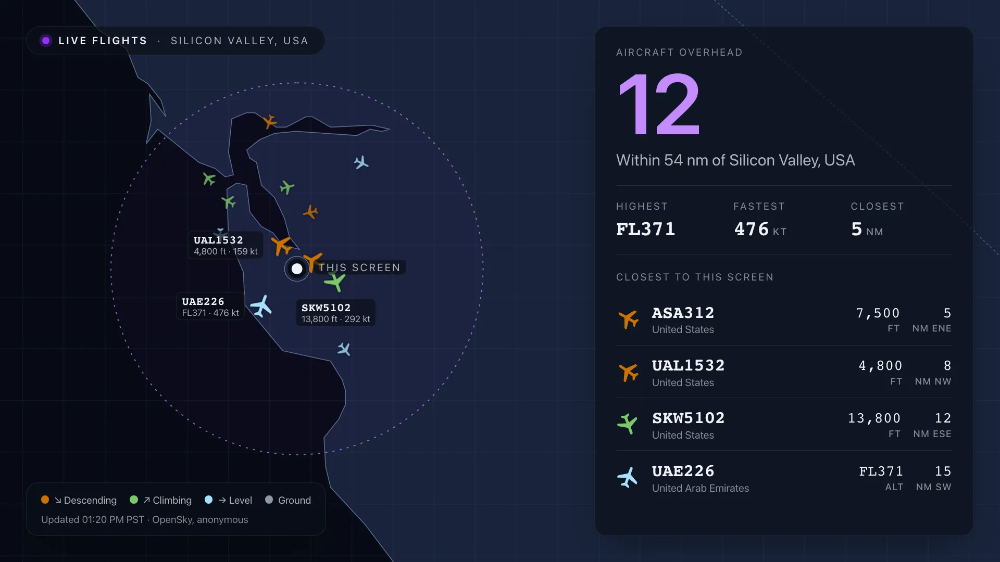
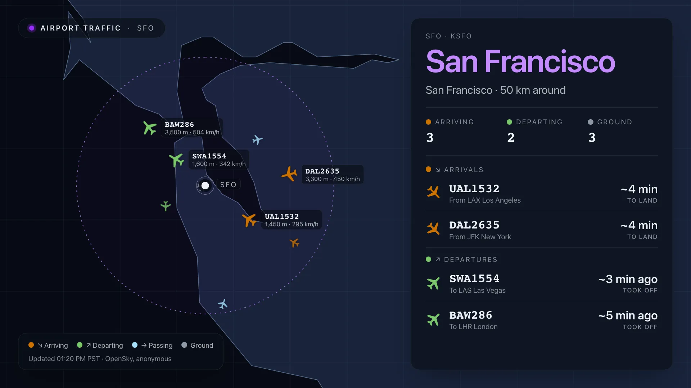
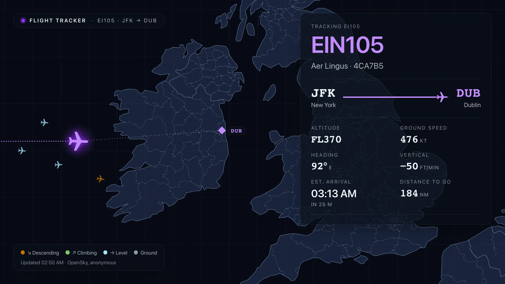
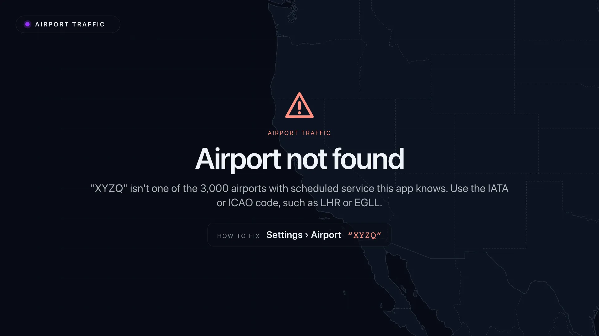

[](https://github.com/Screenly/opensky-live-app/releases/latest)

# OpenSky Live — Screenly Edge App



Live air traffic from [The OpenSky Network](https://opensky-network.org/),
drawn on a full-bleed map with the numbers in glass panels. Three modes, chosen
with the **What to Show** setting:

| Mode                   | Setting values                  | Shows                                                                                                                                         |
| ---------------------- | ------------------------------- | --------------------------------------------------------------------------------------------------------------------------------------------- |
| **Around this screen** | `mode: area`, `radius_km`       | Every aircraft within the radius, the closest listed, highest / fastest / closest.                                                            |
| **Airport**            | `mode: airport`, `airport`      | Arriving, departing and on-ground counts, and the inbound and outbound traffic.                                                               |
| **Flight**             | `mode: flight`, `flight_number` | One flight followed across the map: From → To (e.g. MLE Malé → DEL Delhi), progress, estimated arrival, flown path, altitude, speed, heading. |




Every aircraft is coloured by **what it is doing** and drawn pointing along
its track. Its altitude is shown as a number, in its tag and in the list.
That number is OpenSky's pressure altitude, worked out from air pressure on a
standard day, not height above the ground, so an aircraft on short final or
on a high-pressure day can read 0 or below sea level while still flying.
Anything airborne under 100 ft (30 m) is shown as **<100 ft**; an aircraft
reporting itself on the ground shows **GND**. Right after touchdown a
transponder can take a few seconds to switch to "on the ground", so a landing
aircraft may read <100 ft briefly before it becomes GND.

| Colour | At an airport | Anywhere else |
| ------ | ------------- | ------------- |
| Orange | ↘ Arriving    | ↘ Descending  |
| Green  | ↗ Departing   | ↗ Climbing    |
| Blue   | → Passing     | → Level       |
| Grey   | Ground        | Ground        |

Each meaning keeps the same hue in both themes; the followed flight wears
the purple accent. The palette was chosen with the dataviz validator (all
pairs, accent included): colour-blind separation ΔE 12 dark / 9.5 light,
normal vision 20.5 / 17.9, against targets of 8 and 15. Words and arrows
(the legend, the board's ↘ Arrivals / ↗ Departures headings) say the same thing, so colour
is never the only cue. Between refreshes each one
keeps moving along its last known course and speed, so the map is alive even
though OpenSky is only asked every few minutes.

## Settings

- **Airport** takes an IATA or ICAO code (`LHR` or `EGLL`). The ~3,000 large
  and medium airports with scheduled service are bundled, so there is no lookup
  call.
- **Flight Number** takes what is printed on a ticket (`BA283`), an ICAO
  callsign (`BAW283`) or a 6-character ICAO24 transponder address (`4ca7b5`).
  Aircraft transmit ICAO callsigns, so IATA flight numbers are translated
  through a bundled airline table (`BA` → `BAW`). Some airlines fly under
  alphanumeric callsigns that differ from the flight number (`BAW25M`); for
  those, enter the callsign itself.
- **Units**: aviation (ft / flight levels, kt, nm), metric or imperial.
- **Theme** (advanced): dark (radar, purple `#972eff` accent) or light
  (paper, deep purple `#6d28d9` accent). The accents are fixed per theme.
- **OpenSky Client ID / Secret** (optional): an API client from the OpenSky
  account page. See _Credits and refresh_ below.
- **Override Coordinates**: centres _Around this screen_ somewhere other than
  the player's own position, and is used for the "From this screen" distance in
  flight mode.

## The airport board

Three counts — **Arriving**, **Departing**, **Ground** — and below them a
board laid out like a terminal's, in two sections:

| Section          | Each row                                      | Time                                 |
| ---------------- | --------------------------------------------- | ------------------------------------ |
| **↘ Arrivals**   | callsign, _From LAX Los Angeles_ (or country) | **~5 min** to land, or **Landing**   |
| **↗ Departures** | callsign, _To LAS Las Vegas_ (or country)     | **~4 min ago**, or **Just departed** |

Whether a flight is arriving or departing comes from what it is doing now:
descending is an arrival, climbing a departure; away from the airfield it
must also point at (or away from) the airport. On the airfield itself
(within 6 km), pointing means nothing — runways run through the airport's
reference point, so a take-off from the far end points straight at it — so
only climb or descent counts. An aircraft that is level there, as at the
moment of lift-off before OpenSky reports a climb, is placed by its route if
one starts or ends here (UAL1111, SFO → Lihue: departing), and otherwise
left off the board for that moment rather than guessed. A measured climb or
descent always beats the route, which may be stale.

Each section is in time order, as a terminal board is: arrivals by **soonest
to land**, departures by **latest to take off** — so a fast jet further out
lands before a slow one closer in. Anything without a usable time estimate
goes last. Rows are trimmed from whichever section has more until the board
fits, so a busy stream of arrivals cannot push departures off.

The times are estimates, marked with **~**: OpenSky has positions, not
schedules. Time to land is distance to the airport at current ground speed —
vectors and holds make it longer. Time since take-off is distance flown at
the average of lift-off speed (~145 kt) and current speed, since a climbing
aircraft is still accelerating. Anything barely moving (or with a bad speed
reading) shows **—** rather than a guess. Altitude and distance are not on
the board; they stay on each aircraft's map tag.

On the map, aircraft on the ground pile up on aprons, so wherever their grey
icons would overlap, **at most two** are drawn: two overlapping still read as
two aircraft, a dozen do not. The Ground count still counts every one. Only
the ground is thinned — aircraft in the air, labelled ones and the followed
flight are always drawn.

Aircraft on the ground are counted but not listed; aircraft passing through
are the airspace's, not the airport's, and are neither. Both stay on the
map, in grey and blue. Each section's heading carries its colour key, and
each row's icon wears the same colour as on the map.

Aircraft on the ground are counted within 6 km of the airport, so a
neighbouring airport's apron (Gatwick, seen from Heathrow) is drawn on the
map but not counted. OpenSky only sees aircraft on the ground where a
volunteer receiver can see the airport's surface: Heathrow, Frankfurt and San
Francisco show dozens; airports without that coverage (Mumbai and Kochi at
the time of writing) show 0.

## Private flights

Private aircraft fly under their **registration** (N780SP, OEELK), which
identifies the owner. A public screen shouldn't broadcast private
individuals' movements — in the US, owners can even ask the FAA to keep
their aircraft out of public tracking (LADD / PIA) — and an airport board is
about airline flights anyway. So by default they are **drawn on the map but
never named or listed**: not on the board, not in the Arriving and Departing
counts, not in the "closest to this screen" list, and never labelled.

A flight counts as public when its callsign has an operator's three-letter
code and a number (UAL1050, SKW425X, MXY812). The shape is the test, not a
table of airline codes, which would be missing newer airlines (Breeze, JSX)
and hide their flights. Business-jet charters and some military flights use
the same shape (NetJets "EJA", the RAF's "RRR") and are listed.

Flights by business-jet operators — NetJets, Flexjet, VistaJet, XOJET,
Gama Aviation, flyExclusive — use the airline shape and are listed, labelled
**Private jet · Flexjet**; in flight mode, **Flexjet · Private jet**, with
the airport OpenSky saw it take off from and "Not published" for where it
is going. The operator, a company, is named; owners are never looked up.
The list of operator codes is short and each code is confirmed against
adsbdb; a code not on it reads as an ordinary flight.

The **Show Private Flights** setting (advanced) lists them too — for an
aero club, say. Flight mode is not affected: a registration typed into
Flight Number is followed as asked.

## Where flights overhead are coming from and going to

In **Around this screen** mode, each row in the list shows the flight's
journey under its callsign — **MUC Munich → DXB Dubai** — from the same
OpenSky flight-route service as the airport board. For a flight with stops
it is the leg the aircraft is flying now; a route the aircraft is clearly
not on (a reused flight number) is not shown, and the row shows the
aircraft's country instead. Routes are looked up for the twelve nearest
flights, in one request, and remembered on the screen.

## Where airport traffic is coming from and going to

Each board row says where the flight is from or going — **From IAH
Houston**, **To HNL Honolulu**. Routes come from **OpenSky's own
flight-route service**, the one behind its live map
(`flightroutes.opensky-network.org/api/routeset`): free, no key, no
credits, and batched, so one request answers the whole board. It is not part
of OpenSky's documented REST API, so it may change without notice;
[adsbdb](https://www.adsbdb.com/) is the fallback for the few flights it
has nothing for.

Routes are itineraries: a flight that stops here (SKW6274, LAX → SFO → LAX)
has a leg in and a leg out, and the board uses the leg that lands here for
an arrival, the one that leaves here for a departure. A route with no leg
through this airport is not shown. If its leg ends or starts at a
**neighbouring** airport instead (within 100 km: Gatwick, Luton, Stansted or
City, seen from Heathrow), the flight is that airport's, not this one's — a
descent into Gatwick looks like a descent into Heathrow from the map alone —
so it is left off this board and its counts, and drawn as passing on the
map.

Rows with no usable route show the aircraft's country: private aircraft
flying under their registration, military flights, and callsigns neither
source knows.

Each callsign is looked up once per airport and remembered on the screen
for three days (twelve hours if unknown); up to 30 new callsigns per
refresh in one OpenSky request, and at most four adsbdb fallbacks. City
names come from the bundled airport table, which lists each airport's own
town: Athens appears as Spata-Artemida.

## Out of receiver range (flight mode)

OpenSky only hears aircraft near its volunteer receivers, so a flight over
an ocean drops out of its data — ASA815, San Diego to Honolulu, vanishes a
few hundred miles off the coast. A followed flight that disappears **at
cruise altitude** has not landed: the app keeps it, carries it on along its
route at its last speed, and draws it **faded**, with the panel saying
**out of receiver range, last seen 12:20 AM**. Progress, estimated arrival
and distance to go carry on from that estimate.

It goes back to live tracking as soon as OpenSky hears it again (near
Hawaii, say). While lost, OpenSky is asked every 5 minutes signed in (20
anonymously), since finding it is a worldwide query. The estimate stops 30
minutes after its estimated arrival — 12 hours if its route is unknown — and
only then does the screen say it is not in the air.

A screen with no last position of its own — set up while the flight was
already out of range — asks OpenSky instead: which aircraft flew the
callsign out of its origin (OpenSky's departure records), and where that
aircraft's recorded path ends. A screen that has seen the flight live even
once remembers its transponder and goes straight to the path. Only if
neither works — OpenSky's departure list does occasionally leave a flight
out (it did for ASA815) — does it say the flight is not in the air until it
is heard again.

## Times and timezones

Every time on screen carries its timezone — **Updated 12:55 AM IST**,
**last seen 12:39 AM PDT** — so it is never ambiguous to someone reading it
from elsewhere. Times are in the screen's own zone, worked out from its
location (or Override Coordinates), so they are right even on a player
whose clock runs in UTC. **Override Timezone** (advanced) sets one by name,
such as `America/Los_Angeles`.

A flight's **estimated arrival** is the exception: it is in the
**destination's** time, as airlines and arrivals boards give it, with the
screen's own time underneath when the two differ:

> **04:59 AM**
> HST · in 4 h 40 m
> 07:59 AM PDT here

Zones are shown by their everyday abbreviation (PDT, HST, BST, IST, AEST)
where one exists, and by their offset otherwise (GMT+5 for the Maldives).

## Route and estimated arrival (flight mode)

OpenSky's positions carry no route, so it comes from OpenSky's flight-route
service (see above), using the leg of the itinerary the aircraft is actually
on, with adsbdb as the fallback and for the airline's name. It is looked up
once per callsign and cached.

- The panel shows the two airports (`AMD Ahmedabad → PNQ Pune`), a progress
  bar, the estimated arrival time and the distance to go. The map pins both
  airports and draws the remaining leg; when the destination is close enough,
  the view is framed to hold both the aircraft and the airport.
- The estimate is the straight-line distance to go at the current ground
  speed. It ignores the descent and routing, so it is labelled "Est." and is
  not a scheduled time.
- A flight that is not in the air still shows its route ("MLE Malé → DEL
  Delhi · Not in the air right now"), with the map behind it centred on the
  route. OpenSky has no position either before departure or after landing and
  cannot say which, so the wording does not guess. There are no scheduled
  times: that would need a paid schedule API.
- A callsign is sometimes reused for a different leg. If the aircraft is not
  roughly between the two airports, the route is treated as wrong and hidden.
- If adsbdb doesn't know the callsign (private flights, some airlines) or
  can't be reached, the panel shows the squawk and distance from this screen
  instead, as before.

## When something is wrong

A setting the app can't use gets a full-screen notice instead of an empty
map: a warning mark, what is wrong in plain words, and a **How to fix** hint
naming the exact setting and quoting what was typed.

| Situation                    | Notice                                                       |
| ---------------------------- | ------------------------------------------------------------ |
| Unknown airport code         | Airport not found · Settings › Airport "XYZQ"                |
| Airport mode with no airport | No airport set · Settings › Airport                          |
| Unreadable flight number     | Not a flight number · Settings › Flight Number "hello!"      |
| Flight mode with no flight   | No flight set · Settings › Flight Number                     |
| No screen location           | No location set · Settings › Override Coordinates            |
| Bad override coordinates     | Coordinates not understood · Settings › Override Coordinates |
| Start-up fault               | Something went wrong (reported to Sentry when configured)    |

OpenSky being down with nothing cached is not shown at all: the app doesn't
signal ready, so the player keeps its previous content (see _Ready signal_).

A flight that is simply not in the air is not an error: it gets the aircraft
mark, its route and the next check time.



## Ready signal

`ready_signal: true` is set in the manifest, per the Edge Apps standard, so
the player keeps the app hidden until `screenly.signalReadyForRendering()` is
called. `src/ready.ts` follows the 8-bit fireplace's pattern:

- **Synchronously, right after drawing.** No wait for an animation frame:
  frames don't run while the player hides the app, and it stays hidden until
  it signals, so that wait would time out on Pi / Player Max and the asset
  would be skipped.
- **Only when there is something worth showing:**

  | Situation                                                | Signal                          |
  | -------------------------------------------------------- | ------------------------------- |
  | Positions drawn, live or from the last good reading      | Yes                             |
  | A followed flight that OpenSky reports is not in the air | Yes                             |
  | A setting to fix (airport, flight number, credentials)   | Yes, so an operator sees it     |
  | Start-up crash                                           | Yes, so the player is not held  |
  | Still connecting                                         | **No** — no "connecting" screen |
  | OpenSky down and nothing cached yet                      | **No** — retried every 30 s     |

  Without a signal the player keeps showing what came before and moves on;
  once OpenSky answers, the next showing has data. (A cached reading is shown,
  marked stale, rather than nothing.)

- **Once.** Later calls do nothing.

The trail and route lookups in flight mode run in parallel, so the first
screen — and its signal — comes as soon as possible.

`e2e/ready.spec.ts` checks each row above, including a run where animation
frames never fire and one where OpenSky comes back after an outage.

## OpenSky credentials (optional)

Without credentials the app uses OpenSky anonymously: 400 credits a day,
counted per internet address, so **every screen on the same network shares
them**. A free OpenSky account with an API client raises that to 4,000 a day,
counted per account.

1. Create a free account at [opensky-network.org](https://opensky-network.org/)
   and log in.
2. Open your [Account page](https://opensky-network.org/my-opensky/account) and
   create an **API client**. OpenSky shows its `client_id` and
   `client_secret`.
3. In Screenly, open this app's settings, show the **Advanced** settings, and
   paste the `client_id` into **OpenSky Client ID** and the `client_secret`
   into **OpenSky Client Secret** (stored as a secret).

That is all. With both filled in, the app signs in (OAuth2 client
credentials), sends the 30-minute token with every OpenSky request and renews
it as needed. The status line at the bottom says which mode it is in:
`Updated 12:04 · OpenSky, signed in` or `· OpenSky, anonymous`.

| Situation                        | What the screen does                                    |
| -------------------------------- | ------------------------------------------------------- |
| Both blank                       | Anonymous access, 5-minute refresh                      |
| Both filled in, accepted         | Signed in, 1-minute refresh                             |
| Only one filled in               | "Client ID and secret both needed", nothing is fetched  |
| OpenSky refuses them (`401`)     | "Sign-in not accepted", with the settings to fix        |
| OpenSky's sign-in server is down | Treated like any outage: the last reading, marked stale |

A refused sign-in is shown even when older positions are cached: it is a
setting to fix, and riding it out on stale data would hide it.

### How many screens fit

|                                | Anonymous (400/day) | Signed in (4,000/day)                                   |
| ------------------------------ | ------------------- | ------------------------------------------------------- |
| One screen, default refresh    | 288 — fits          | 1,440 — fits                                            |
| Two screens, default refresh   | 576 — **over**      | 2,880 — fits                                            |
| Three screens, default refresh | 864 — **over**      | 4,320 — **over**: set Refresh Interval to 120 s or more |

Flown paths in flight mode come from a separate allowance and are refreshed
every 30 minutes anonymously (192 credits a day) or every 10 signed in. If
that allowance runs out, the path stops updating until OpenSky's reset; the
aircraft's position keeps updating.

## Credits and refresh

OpenSky meters its API in credits, per day, per IP for anonymous use:

|                         | Anonymous | With a client |
| ----------------------- | --------- | ------------- |
| Daily credits           | 400       | 4,000         |
| Default refresh         | 300 s     | 60 s          |
| Fastest allowed refresh | 240 s     | 30 s          |

A query for a box up to 25 square degrees costs 1 credit — a 100 km radius
stays inside that — and a worldwide query costs 4. The app keeps to the cheap
end:

- The last reading is cached. A playlist that shows the app every minute does
  not refetch until the refresh interval has passed.
- A followed flight is searched for worldwide once, then re-found in a 300 km
  box around its last position.
- A flight that is not airborne is checked again after 20 minutes (5 with a
  client), not every refresh.
- A `429` honours OpenSky's `X-Rate-Limit-Retry-After-Seconds`.

Sign-in is OAuth2 client credentials; OpenSky no longer accepts username and
password. Tokens are reused until a minute before they expire.

## Behaviour when the feed fails

This follows the Edge Apps failure-mode algorithm. Credentials are optional —
the API is public — so only the data half of the diagram applies:

| Feed   | `display_errors`   | Result                                     |
| ------ | ------------------ | ------------------------------------------ |
| Fresh  | —                  | Draw the cached reading, no request        |
| OK     | —                  | Cache it, draw it                          |
| Failed | on                 | Show the error                             |
| Failed | off, cache present | Draw the last reading, status marked stale |
| Failed | off, no cache      | Say it is unavailable                      |

`screenly.signalAbort()` does not exist yet (Phorge T10903), so the last row
says what happened and signals ready anyway. OpenSky is given 8 seconds, inside
the screenshotter's budget.

## How it works

- `src/data.ts` — what to fetch for each mode, the cache shape, the refresh
  policy and dead reckoning.
- `src/opensky.ts` — the API client: OAuth token, CORS proxy, rate limits.
- `src/states.ts` — the state-vector wire format, parsed and narrowed.
- `src/map.ts` — the equirectangular map, markers and collision-free labels.
- `src/panel.ts` — the glass panel for each mode.
- `src/traffic.ts` — what each aircraft is doing (its colour), and the
  arrival / departure heuristic: low, descending and pointed at the field is
  an arrival; low, climbing and pointed away is a departure. Elsewhere,
  vertical speed past ±300 ft/min is descending or climbing.
- `src/lookup.ts` — airports and flight numbers.

The map is the same public-domain Natural Earth outline as the Earthquake app,
injected from `src/world.svg`, with Natural Earth's state and province
boundaries for every country drawn over it as thinner dashed lines, so an
inland view (Delhi, Madrid, Denver) still has landmarks. Those come from
`src/states.json`, generated by `node scripts/generate-boundaries.mjs`:
simplified to about 2 km, rounded to about 1 km, and cut into 10° tiles. The
map draws only the tiles under its window — a few dozen lines rather than
the world's 45,000 — and none in a whole-world view, where they would be
noise. They add about 1.2 MB to the single-file build. Every size is a multiple of one unit — a
hundredth of the screen's width, or of its height scaled to 16:9, whichever is
smaller — so the layout fills any screen shape. In portrait the panel drops
below the map. The build is folded into one self-contained `index.html` by
`scripts/inline-bundle.mjs`.

`src/airports.json` and `src/airlines.json` are generated from
[OurAirports](https://ourairports.com/data/) (public domain) and
[OpenFlights](https://openflights.org/data) (ODbL) by
`bun run generate-reference-data`, and committed so builds stay offline.

## Accessibility

Every text and component colour is held to **WCAG AA** in both themes by
`src/contrast.test.ts`, which reads the tokens straight out of `src/style.css`:

- 4.5:1 for all text. The 3:1 large-text allowance is not used, because sizes
  scale with the screen and are small on 800×480 players.
- 3:1 for components and meaningful graphics: aircraft, legend dots, airport
  pins, the radius ring, flight paths, the progress bar and coastlines.
- Translucent layers are composited first, and each colour is measured over
  both sea and land, so the worst case is what passes.

Map labels sit on a glass backing above ordinary aircraft, so an aircraft never
covers their text. Change a colour, run `bun run test`.

## Development

```bash
bun install
bun run dev
```

`dev` starts the CORS proxy alongside the dev server, so OpenSky is reachable
locally. Edit `mock-data.yml` to switch modes; there are commented examples.

```bash
bun run type-check
bun run lint
bun run format
bun run test         # unit tests
bun run screenshots  # Playwright, against mocked OpenSky data
```

## Deployment

Create and deploy the Edge App (first time):

```bash
screenly edge-app create --name opensky-live-app --in-place
bun run deploy
screenly edge-app instance create
```

Or use the manual **Initialize Edge App** GitHub Action for stage, then
production. After each run, set `STAGE_EDGE_APP_ID` /
`PRODUCTION_EDGE_APP_ID` from the printed id. Both environments need the
`SCREENLY_API_TOKEN` secret.

To deploy by hand later:

```bash
bun run deploy
```

The manifest's icon points at
`https://playground.srly.io/edge-apps/icons/opensky-flight-map.svg`; upload
`icon.svg` there before the first deploy.

### Releasing

Pushes to `master` deploy to stage automatically. To release to production,
tag a commit on `master` and push the tag (the workflow refuses tags not on
the default branch):

```bash
git checkout master && git pull
git tag v26.10.0
git push origin v26.10.0
```

Then publish a GitHub Release whose notes list the pull requests merged since
the previous release. Add `--draft` to review the notes before publishing:

```bash
gh release create v26.10.0 --verify-tag --generate-notes --title v26.10.0
```

Use the `vYY.M.PATCH` scheme (e.g. `v26.10.0` for the first release in
October 2026, `v26.10.1` for the next one that month).

Flight data © The OpenSky Network, used under its
[terms of use](https://opensky-network.org/about/terms-of-use).
